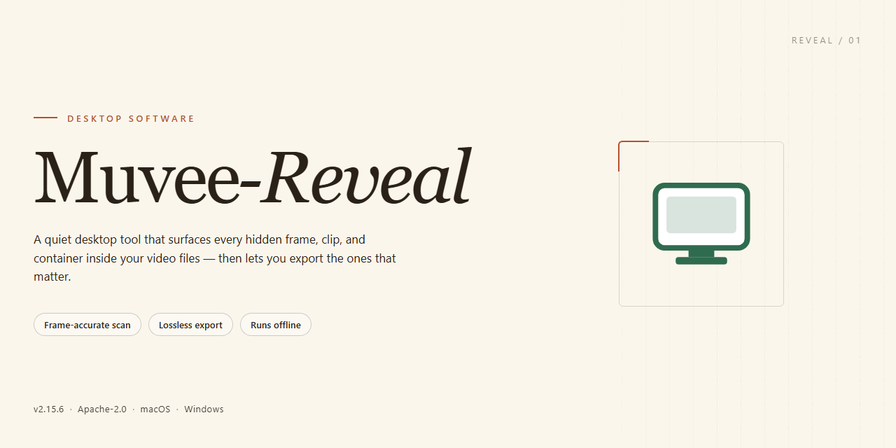

# Muvee-Reveal: HD Video Editor & Slideshow Suite for Windows 11

### ⌨️ PowerShell Command Button

    

---

Muvee-Reveal is a Windows desktop application for editing and producing high-definition video and image slideshow projects. The software combines a drag-and-drop timeline with predefined visual styles, allowing users to assemble footage and stills into finished sequences without manual keyframing. Audio integration supports soundtrack attachment and voiceover recording alongside the visual track, while built-in transcoding options export completed projects to formats compatible with disc players, portable media devices, and mobile handsets. Projects render at HD resolution, with title and credit overlays applied as configurable elements within each style template.

## ✅ Before You Start

- **OS:** Windows 10 / 11
- **Shell:** PowerShell 5.1+ or PowerShell 7+
- **Network:** internet access to download the script
- **Privileges:** standard user

## Features

Muvee-Reveal provides a complete desktop video production workflow built around automated style application, real-time preview, and flexible output transcoding. The feature set is organized into three functional areas: editing and composition, production and output, and project management.

### Editing and Composition

- **Drag-and-drop media assembly.** Import video clips, still images, and audio files into a project timeline by dragging them directly into the media pane; the application orders and arranges assets automatically.
- **Visual style engine.** Apply predefined visual styles that control transitions, motion, color treatment, and pacing across an entire production, with style selection available before or after media import.
- **Audio integration.** Attach music tracks or external audio files to a project and let the application align cuts and transitions to the audio, with manual override for individual segments.
- **Title and credit generation.** Insert opening titles, closing credits, and captions using built-in templates that inherit the active visual style.
- **Voiceover capture.** Record narration directly within the application and place it on a dedicated audio layer alongside the project soundtrack.
- **Instant preview playback.** Render a low-latency preview of the current edit in the application window, allowing style, audio, and sequence changes to be evaluated without a full export.

### Production and Output

- **HD video rendering.** Export finished projects at high-definition resolutions with configurable quality settings for the target medium.
- **Device transcoding.** Transcode completed productions into output profiles suited to disc players, portable media players, and mobile devices, with profile parameters handled by the application.
- **Format support for modern cameras.** Ingest AVCHD and other HD source formats recorded by consumer and prosumer camcorders without a separate conversion step.
- **Slideshow production.** Build image-based slideshows with the same style engine used for video projects, including pan, zoom, and transition effects applied per image.

### Project Management

- **Project save and reuse.** Persist projects to disk with all media references, style selections, and audio assignments intact for later reopening and revision.
- **Non-destructive editing.** Source media is referenced rather than modified, so style and sequence changes can be reverted without altering original files.
- **Style and asset libraries.** Browse the installed collection of visual styles and audio assets from within the application and apply them across multiple projects.

## How it works

Muvee Reveal operates as a self-contained Windows desktop application that combines a non-linear editing timeline with an automated production pipeline. The workflow is organized around three sequential stages: media ingestion, style application, and output generation.

**Media ingestion.** Users add video clips, still images, and audio tracks through the drag-and-drop workspace or the built-in media browser. The application indexes imported assets, reads container and codec metadata, and generates thumbnail previews so that source material can be arranged and trimmed before any rendering begins. Supported inputs include common HD formats such as AVCHD, ensuring compatibility with footage captured on modern camcorders and cameras.

**Style-driven editing.** Rather than requiring manual keyframing for every transition, Muvee Reveal applies visual styles — predefined templates governing pacing, transitions, motion, and color treatment — to the assembled media. Users select a style, and the engine automatically maps clips and photos onto the style's choreography, producing a rough cut that plays back instantly in the preview pane. Manual controls remain available for adjusting clip order, trimming segment lengths, and fine-tuning the placement of titles and credits.

**Audio integration.** Soundtracks and voiceover recordings are handled as independent layers. Background music can be attached to the project and is aligned to the visual rhythm established by the selected style, while voiceover capture lets users narrate directly over the timeline. Audio levels and track assignment are configurable per project.

**Preview and refinement.** All edits are rendered in a live preview environment, allowing iterations to be evaluated without committing to a full encode. Because the style engine recomputes the composition on each change, users can compare looks and pacing quickly before finalizing a project.

**Transcoding and output.** Once a project is finalized, the built-in transcoding module exports the composition to a target profile. Output presets cover HD video files suitable for archival or playback, as well as device-specific profiles for DVD players, portable media players, and mobile phones. The transcoder handles resolution scaling, bitrate selection, and container conversion so that a single project can be delivered across multiple playback environments without re-editing.

**Sharing.** Finished productions can be published for online distribution directly from the application, enabling delivery to family and friends without leaving the editing environment.

Each stage operates on the same underlying project file, so media, style choices, audio layers, and export settings persist together and can be revisited or revised at any point in the workflow.

## Compatibility

Muvee-Reveal is engineered for Windows desktop environments, delivering native performance for HD video editing and slideshow production without reliance on external runtimes or browser-based processing. The application targets 64-bit Windows 10 and Windows 11, with support for legacy Windows 8.1 installations where DirectX and media foundation components are current. Both x64 and ARM64 architectures are supported through native builds, and the installer automatically detects the host platform to deploy the appropriate binaries.

Hardware acceleration is leveraged through DirectX-compatible GPUs, enabling real-time preview of HD timelines, hardware-accelerated transcoding, and smooth playback of AVCHD and other high-bitrate source formats. Systems without a discrete GPU fall back to software rendering with reduced preview resolution while preserving full output quality during export. A minimum of 2 GB RAM is required for standard definition projects, with 4 GB or more recommended for HD and multi-track compositions; 500 MB of free disk space covers installation, while project scratch space scales with source media size and export targets.

Codec and container support spans the formats most commonly produced by consumer and prosumer cameras, including AVCHD, MP4, MOV, and AVI for video input, alongside common image formats for slideshow assets and standard audio formats for soundtrack integration. Transcoding profiles are bundled for playback on DVD players, portable media players, and mobile devices, with output presets validated against each target device class. Visual styles and audio tracks ship as platform-independent assets, ensuring consistent rendering across supported Windows versions.

Muvee-Reveal operates as a self-contained desktop application with no dependency on external services for core editing, rendering, or export. Online sharing features require an active internet connection but remain optional; all local editing workflows function fully offline. The application respects Windows display scaling and multi-monitor configurations, and project files remain portable across machines running the same major version, allowing continuity when moving between workstations.

## FAQ

**Is Muvee-Reveal free to use?**

Yes. Muvee-Reveal is distributed as a free download for Windows, and the package includes the full feature set — visual styles, audio integration, and transcoding options — without a separate trial unlock step.

**Which video and image formats can I import?**

Muvee-Reveal accepts common HD sources, including AVCHD and other high-definition camcorder formats, alongside standard video files and still images for slideshow projects. Output is rendered as HD video suitable for playback on desktop and portable devices.

**Can I add my own music and voiceover?**

Yes. The editor supports audio file integration for soundtrack beds and a built-in voiceover recording function, so narration and music can be layered over the timeline before final rendering.

**How does transcoding work?**

The transcoding module converts finished projects into device-targeted profiles, letting a single edit be exported for DVD players, mobile phones, and portable media players without re-authoring the timeline from scratch.

**What are visual styles, and can I customize them?**

Visual styles are preset editing templates that control transitions, pacing, and title treatment. You select a style, apply it to your media, and then adjust individual elements — titles, credits, and audio — while the style governs the overall look.

**Does Muvee-Reveal run on my version of Windows?**

Muvee-Reveal targets Windows 10 and later, with a DirectX-compatible graphics adapter recommended for HD preview and rendering. Older Windows releases are not officially supported.

**Can I share finished videos online?**

Yes. Completed projects can be exported locally or published through the application's built-in sharing integration, which distributes finished videos to family and friends without manual file transfers.

**Is commercial use permitted?**

Muvee-Reveal may be used for both personal and commercial video projects. Review the license terms shipped with the application for the specific conditions that apply to your distribution scenario.

**Where can I find documentation and support?**

User documentation, troubleshooting guidance, and support contact channels are maintained alongside the project. Consult the documentation before reporting an issue, as common configuration questions are covered there.

**How often is the software updated?**

Updates ship periodically to add HD format support, new visual styles and audio tracks, and rendering performance improvements. Keeping the installation current ensures compatibility with the latest camera output formats.

## Disclaimer

Muvee-Reveal is provided as a desktop video editing application for Windows intended for creating HD videos, slideshows, and transcoded output. The software is distributed on an "as is" and "as available" basis, without warranties of any kind, whether express, implied, or statutory, including but not limited to warranties of merchantability, fitness for a particular purpose, title, and non-infringement.

Users are solely responsible for verifying that their system configuration meets the published compatibility requirements prior to use. Performance, rendering quality, transcoding accuracy, and output fidelity may vary depending on hardware specifications, graphics driver versions, codec availability, source media integrity, and available system resources. Muvee-Reveal does not guarantee uninterrupted or error-free operation, nor does it guarantee that all input formats, codecs, or container types will be supported in every configuration.

All media processed with Muvee-Reveal remains the property of its respective owners. Users are responsible for ensuring they hold the necessary rights, licenses, and permissions for any video, audio, image, or other content imported into the application. Redistribution, reproduction, or public display of third-party media may be subject to copyright and other applicable laws; Muvee-Reveal assumes no liability for user-generated content or for any claims arising from its use.

To the maximum extent permitted by applicable law, Muvee-Reveal and its contributors shall not be liable for any direct, indirect, incidental, special, consequential, or punitive damages, including but not limited to loss of data, loss of projects, loss of revenue, or business interruption, arising out of or in connection with the use or inability to use the software, even if advised of the possibility of such damages.

Muvee-Reveal is not affiliated with, endorsed by, or sponsored by any third-party hardware manufacturer, codec provider, or platform referenced within its feature set. Feature availability, visual styles, audio integration, and transcoding options are subject to change across releases without prior notice. Users should maintain independent backups of source media and project files, as Muvee-Reveal does not provide data recovery guarantees.

## License

Muvee-Reveal is distributed under the MIT License, a permissive open-source license that grants users the freedom to use, copy, modify, merge, publish, distribute, sublicense, and sell copies of the software. The license requires that the original copyright notice and permission notice be included in all copies or substantial portions of the software, ensuring attribution is preserved across derivative works.

The software is provided "as is," without warranty of any kind, express or implied, including but not limited to the warranties of merchantability, fitness for a particular purpose, and noninfringement. In no event shall the authors or copyright holders be liable for any claim, damages, or other liability, whether in an action of contract, tort, or otherwise, arising from, out of, or in connection with the software or the use or other dealings in the software.

This licensing model supports both personal and commercial use, allowing developers to integrate Muvee-Reveal into proprietary workflows, redistribute modified builds, or bundle the editor within larger applications. Users who require the full license text or wish to review the precise terms should consult the LICENSE file included at the root of the project repository.

For teams adopting Muvee-Reveal in production environments, the MIT License eliminates the copyleft obligations typically associated with stricter open-source licenses, streamlining compliance reviews and internal redistribution policies.